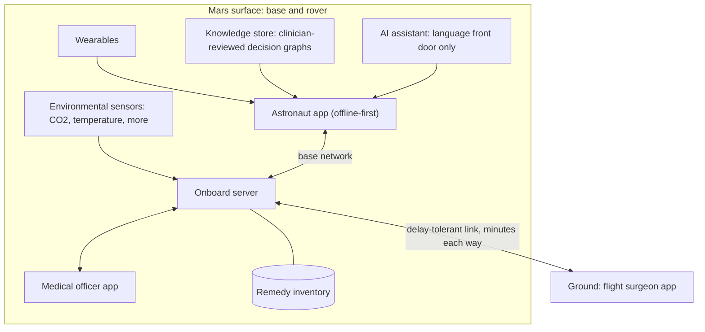
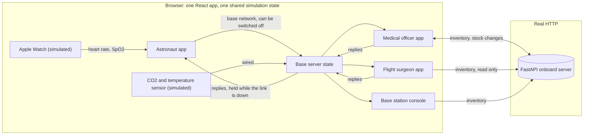

# Baymin: Mission Health

**Health support that keeps working when Earth is far away.**

Baymin helps astronauts check on their own health, work through symptoms step by step, and tell the onboard medical officer and the flight surgeon on Earth what happened, even when the link home is slow or down.

Built for the NASA Space Apps Challenge. [TODO: add the challenge name, team name and links to the demo video and live demo.]

> **Prototype, not a medical device.** Everything in this repository is a demonstration. The crew, readings, alerts and inventory are fictional. The symptom flows and the medications named in them have **not** been reviewed by a clinician and are not medical advice. See [Limitations and safety](#limitations-and-safety).

---

## Contents

1. [What it does](#what-it-does)
2. [The proposed system and the demo, at a glance](#the-proposed-system-and-the-demo-at-a-glance)
3. [The problem](#the-problem)
4. [Part 1: The proposed system](#part-1-the-proposed-system)
5. [Part 2: The demo and simulation](#part-2-the-demo-and-simulation)
6. [Built with](#built-with)
7. [Limitations and safety](#limitations-and-safety)
8. [Roadmap](#roadmap)
9. [References and credits](#references-and-credits)

---

## What it does

Baymin is a health-operations system for crews on long missions, where an instant answer from the ground is not available.

- **For the astronaut:** a mobile app with a daily routine and check-ins, a health history, and a **guided symptom flow**. The astronaut answers simple *yes / no / not sure* questions and is told what to do now, or when to call the medical officer. No medical training is needed to follow it.
- **For the onboard medical officer (CMO):** a crew dashboard with trends, alerts, each crew member's health history, incoming reports to reply to, and the remedy inventory.
- **For the flight surgeon on Earth:** oversight across missions, the same shared health history, incoming reports to reply to, and a read-only view of the inventory.
- **For the base:** a server that receives wearable and environmental readings, correlates them (for example a high heart rate while cabin CO₂ is elevated), raises alerts, and collects reports.

The key ideas:

1. **Act first, report in parallel.** The astronaut gets guidance immediately from an onboard knowledge store. A structured report goes to the medical officer and the flight surgeon at the same time, and the reply can arrive later.
2. **Body and environment together.** Heart rate from a wearable and cabin CO₂ are read side by side, so a headache or a racing heart is not judged in isolation from the air the crew is breathing.
3. **Everything keeps working offline.** Data, reports and replies are queued and delivered when the link returns (store-and-forward).
4. **Expandable knowledge.** Medical flows are *data*, not code. New conditions, including ones specific to space, can be added and reviewed without changing the app.

---

## The proposed system and the demo, at a glance

This repository contains **two different things**, and this README keeps them separate:

- **The proposed system** is the full solution we are proposing for real missions (Part 1).
- **The demo** is the working React and FastAPI prototype we built to show how that system would look and behave (Part 2). It simulates most of the system.

| Capability | Proposed system | In the demo |
|---|---|---|
| Astronaut mobile app | Offline-first native iOS and Android app | **Built** as a React web app, shown inside a phone-sized frame |
| Wearable vitals | Real wearables (for example Apple Watch) streaming heart rate and blood oxygen | **Simulated** with sliders, scenarios and an auto-send option |
| Environmental sensors | Cabin CO₂, temperature and others, in the base and the rover | **Simulated** (CO₂ and temperature) |
| Decision-support knowledge store | Many clinician-reviewed, versioned, sourced decision graphs, including space-specific conditions | **Built**: the engine, a validator, and 3 draft flows (not clinician reviewed) |
| AI assistant | Maps free text or voice to the right flow and interprets answers. It **never** decides treatment | **Not built.** Only a keyword search stands in for it |
| Onboard server | Persistent store, sync, alerting, inventory | **Partly.** Mostly simulated inside the browser. The **remedy inventory is a real FastAPI service** |
| Link between astronaut and base | Delay-tolerant store-and-forward | **Simulated**: a "Base network" switch queues data and replies. Earth–Mars light delay is **not** simulated |
| Medical officer app | Built into the same platform | **Built** (demo) |
| Flight surgeon app | Ground-side tool | **Built** (demo) |
| Health history | Longitudinal data from wearables and check-ins | **Built** with seeded fictional data. Check-ins and watch readings update it live |
| Remedy inventory | Onboard stock, lots, expiry, audit trail | **Built** with fictional data on FastAPI |
| Security and privacy | Encryption, access control, data minimization | **Not built** |
| Clinical validation | Required before any real use | **Not done** |

---

## The problem

On a long mission the crew cannot count on an instant answer from the ground. From Mars a message takes anywhere from a few minutes to over twenty minutes each way, and links can drop for longer. The medicine cabinet is small. The first person to look at a medical problem is usually the person who has it, or a crewmate who is not a physician.

NASA's Human Research Program tracks the risks of human spaceflight, and its Integrated Medical Model documents medical conditions that missions plan for. Both point to the same need: crews need support they can use **right away, offline, and under stress**, and the ground needs to be kept informed without becoming a bottleneck.

---

# Part 1: The proposed system

*This part describes the solution we propose. Not all of it is built; see [Part 2](#part-2-the-demo-and-simulation) for what is.*

## Architecture



| Component | Role |
|---|---|
| **Wearables** | Stream heart rate, blood oxygen and similar signals to the astronaut's phone. |
| **Environmental sensors** | Report cabin CO₂ and temperature to the onboard server. |
| **Astronaut app** | Daily routine, check-ins, journal, health history, the symptom guide, and the astronaut's reports and replies. Works offline. |
| **Knowledge store** | The decision graphs the symptom guide walks through. Stored as data, versioned, with sources and a review status. |
| **AI assistant** | A language layer on top of the knowledge store (see below). |
| **Onboard server** | Receives readings, correlates them, raises alerts, holds the server copy of every crew member's history, collects reports, and routes replies. |
| **Medical officer app** | The on-board clinician's view: roster, alerts, history, reports, replies, inventory. |
| **Ground flight surgeon app** | Oversight across missions, history, reports, replies, read-only inventory. |
| **Remedy inventory** | What is in storage, in which lot, where, and what has expired. Stock changes are recorded with a reason. |

## How it works

A worked example:

1. **Cabin CO₂ rises.** A sensor reports 5,400 ppm to the onboard server. The server raises an alarm and every screen shows a banner.
2. **The astronaut's watch reports a high heart rate.** The astronaut app receives it and prompts: *"Your watch reports 112 bpm. Answer a few questions to see what to do."* The server, meanwhile, notices the high heart rate and the high CO₂ together and raises a **correlation flag** for the medical officer.
3. **The astronaut follows the guide.** The palpitations flow asks about chest pain, shortness of breath, faintness and sweating. Each question has *yes*, *no* and *not sure*. When the astronaut is unsure about a red-flag question, the flow takes the cautious path. It ends in an outcome with a severity level and an ordered list of steps (measure, call, monitor, medication, observe).
4. **A report is built automatically** from the path taken: the questions, the answers, the steps completed, and the recommended steps. The astronaut can add a note.
5. **The report is sent, or queued.** If the link to the base is down, it is saved on the device and sent when the link returns. The astronaut keeps following the guide in the meantime.
6. **The medical officer and the flight surgeon read it and reply.** The reply is attached to the report. If the astronaut's device is not reachable, the server holds the reply and delivers it when the link returns.
7. **The astronaut sees the reply**, with a notification and a marker for new replies.

## The decision-support knowledge store

This is the core of the proposal.

- **Flows are data.** Each condition is a graph of three kinds of node: a **question** (yes, no, not sure), an **action** (a step to do and confirm, optionally timed), and an **outcome** (a severity level and ordered instructions). Flows are plain files that can be reviewed like any other document.
- **Safe by construction.** Every question must define what happens on *not sure*. A validator rejects flows with dead ends, unreachable nodes, missing targets, or accidental cycles. Only deliberate loops (for example "rest 15 minutes, measure again, and start over if still high") are allowed.
- **Five severity levels.** Self-care, monitor, CMO evaluation needed, urgent, and emergency. The level decides how strongly a report to the flight surgeon is recommended.
- **Navigable by people or by an AI.** A small deterministic engine walks the graph. A person walks it by pressing buttons. An AI agent can walk **the same graph** through the same engine, asking the questions by voice or text. Every step is recorded, so the path is auditable.
- **Expandable, with governance.** Each flow carries a version, its sources, and a review status (*draft* or *clinician reviewed*). The plan is to add conditions that matter in space, such as CO₂ exposure, space adaptation symptoms, decompression-related conditions, eye changes, and EVA injuries, each authored from published references and reviewed by clinicians before it is marked reviewed.

## The role of AI

AI has one job: **language**. It can match free text or speech ("my head feels full and the CO₂ alarm went off") to the right flow, and turn an answer like "sort of" into *yes*, *no* or *not sure*.

AI does **not** decide the outcome, the severity, or any treatment. The graph does. That keeps the system explainable, reviewable by clinicians, and free of invented medical advice.

## Benefits

- **Faster, calmer first response.** Clear steps, large touch targets, and plain language for a stressful moment.
- **Works without the ground.** Guidance is on board and offline-first.
- **Keeps the ground informed without delay.** A structured report is generated automatically, so nobody has to describe the event from memory over a slow link.
- **Earlier warning.** Each person's own baseline makes slow changes in sleep, reaction time or stress stand out before they become problems.
- **A fuller picture.** Biometrics and environment are read together.
- **Everyone sees the same history.** The astronaut, the medical officer and the flight surgeon share one health history, so there is a single story.
- **Auditable and reviewable.** Every decision path is logged, and every flow has a source and a review status.
- **Grows with the mission.** New conditions are new data, not a new release.

## What we hope to achieve

- Give crews **medical decision support they can trust and use alone**, with the ground as a partner rather than a dependency.
- Show how **delay-tolerant, offline-first health tools** should behave on missions where communication is slow and intermittent.
- Create an **open, reviewable format** for space medical decision flows that clinicians, not just developers, can read and extend.
- Make **environment-aware health monitoring** normal: heart rate, sleep and cognition understood alongside the air the crew is breathing.

---

# Part 2: The demo and simulation

*This part describes what is actually in this repository: a React front end and a FastAPI service.*

## What it is, and what it is not

The demo shows the system working end to end, for a **fictional mission**: **Artemis X**, a Mars mission in 2034. It is **mission day 340**, the crew's **47th day on Mars**, and they live in a base and work from a rover. The crew is Maya Chen (the astronaut we follow), Jonas Weber, Leah Okafor and Tomas Varga.

**Be clear about what is real and what is not:**

- **All four apps run in one browser tab and share one simulated world.** The "network" between the watch, the astronaut app, the base server, the medical officer and the flight surgeon is simulated in memory. There is no real networking between them.
- **The wearable and the environmental sensors are simulated.** You drive them from a control panel.
- **The only real client–server communication is the remedy inventory,** which talks to a **FastAPI** service over HTTP.
- **Browser storage:** the journal (including voice recordings) and saved symptom-guide reports live in the browser's `localStorage`. They are not sent anywhere.
- Mission dates, crew, readings, thresholds and inventory are **fictional demo values**.

## Try it: a three-minute tour

1. Open the landing page (`/`) and press **Open the demo**. You start on the **Astronaut** screen.
2. In the sensor panel on the right, press the **CO₂ excursion** scenario. A red banner appears, and a **watch alert** appears on the astronaut's home screen.
3. Press **Open the palpitations guide** and answer the questions. When you reach an outcome, press **Save report to send**.
4. Switch to **Medical officer** at the top, open the **Reports** tab, and **reply** (a quick reply works). Do the same as **Flight surgeon** if you like.
5. Switch back to **Astronaut**. The **Reports** tab has a badge and a **NEW REPLY** prompt. Open it to read the reply.
6. Open **Base station**. See the alerts (including the heart rate and CO₂ correlation), the CO₂ chart, the crew reports with their replies, and the **remedy storage**.
7. Switch the **Base network** off in the sensor panel. Save another check-in or reply to a report, and watch it show as **queued** in the event log and **waiting** in the apps. Switch it back on and watch it arrive.
8. As **Medical officer** or **Flight surgeon**, open a crew member's **health history**. Jonas Weber's sleep and reaction time are trending the wrong way, shown in color, shape and text.

Other things to try: change the **simulated date** or run the clock at **60×** or **600×**, switch the **crew context** between the Mars base and the rover, and press **Reset simulation** to start over.

## Running it locally

**Requirements:** Node.js 20 or newer. Python 3.10 or newer for the backend. [TODO: confirm versions.]

**Front end** (`frontend/`):

```bash
cd frontend
npm install
npm run dev
```

Then open the URL the command prints (usually `http://localhost:5173`).

**Back end** (FastAPI): [TODO: add the folder name and the exact commands, for example creating a virtual environment, installing requirements, and starting the server with `uvicorn`.]

The front end calls the API with **relative URLs** (`/api/v1/remedies`), so during development the API must be reachable on the same origin, for example through a Vite dev-server proxy. [TODO: confirm how this is configured in `vite.config.ts`.]

Without the backend, everything in the demo still works except the remedy inventory and the remedy storage view, which show *"Inventory is unavailable. Check the onboard server connection."*

## What is in the demo

### Routes

| Route | What |
|---|---|
| `/` | Landing page: what the project is and how to try it. |
| `/demo` | The simulation. Add `?actor=astronaut`, `cmo`, `surgeon` or `base` to open a specific screen. |

### The demo header

Simulated date and time (UTC), run or pause the clock at 1×, 60× or 600×, crew context (Mars base or rover), **Reset simulation**, and the switch between the four screens. Before the landing date (mission day 294) the apps show *"In transit"* instead of a Mars day.

### The sensor panel

- **Apple Watch** to the astronaut app: heart rate and blood oxygen.
- **CO₂ and temperature sensor** to the base server.
- **Base network** switch for the link between the astronaut app and the base server.
- **Quick scenarios:** *All nominal*, *CO₂ excursion*, and *High heart rate*.
- **Auto-send** for each sensor, and an **event log** showing who sent what to whom, and whether it was delivered or queued.

### Astronaut app

- **Routine** for the day, and **daily checks**: a self-report (sleep quality, stress, energy, mood, light exposure, workload) and a short cognitive battery (sequence, memory recall, selective attention, 30-second reaction test).
- **Journal** with written entries and **voice recordings** (up to 90 seconds), stored only in the browser.
- **History**: a color-coded health history (below).
- **Symptom guide**: the decision flows, with reports.
- **Reports**: the astronaut's own reports, whether each is waiting or received, and the replies from the medical officer and flight surgeon.

### Symptom guide

Three flows, authored by the team and marked **draft**: **palpitations or fast heart rate**, **changes in urine**, and **allergic reaction**. Each question has *yes*, *no* and *not sure*. Outcomes use five severity levels. Saving a report builds a structured report (and a plain-text version) for the medical officer and the flight surgeon.

### Health history

Eleven indicators in five groups, shown for the last 7, 14 or 28 days:

- **Sleep:** duration, quality.
- **Heart and breathing:** resting heart rate, blood oxygen, blood pressure.
- **Cognition:** reaction time.
- **Wellbeing:** perceived stress, mood, energy.
- **Body and activity:** body temperature, exercise.

Values are **color-coded against demo reference ranges**: teal for in range, amber for watch, red for out of range. Every status also has its own **shape** (circle, diamond, square) and a **text label**, so color is never the only signal. Each row shows a trend (improving, worsening, stable), a sparkline, and an expandable chart and table.

The history is **shared**: the astronaut sees their own copy plus anything still waiting to sync, while the medical officer and flight surgeon see the base server's copy. With the base network off, a new check-in appears for the astronaut immediately but not for the others until the link returns. The server view warns if the astronaut's device has been quiet for 30 simulated minutes.

### Medical officer app

Crew roster, behavioral trend flag, mission alerts, each crew member's health history, a **Reports** tab with reply forms, and the **remedy inventory** (editable, through FastAPI).

### Flight surgeon app

Oversight across several missions, trend flags, sleep-window adjustment per astronaut, the shared health history, a **Reports** tab with reply forms, and a **read-only** remedy inventory.

### Base station

The base server's view: **cabin air** (CO₂ chart with the caution and alarm thresholds), **crew vitals**, **alerts** (CO₂, elevated heart rate, and the correlation of the two), **crew reports** with their replies and delivery state, and the **remedy storage** loaded from FastAPI.

## How the simulation works



- **One pure reducer holds the whole world:** the mission clock, the sensors, the astronaut's device, the base server, the health history, reports and replies, and the event log. Every send creates an event.
- **Store-and-forward.** With the base network off, watch data, check-ins and reports queue on the astronaut's device. Replies queue on the server. Both are delivered, in order, when the link returns. The wired CO₂ sensor is unaffected.
- **Base server rules** (demo thresholds, not clinical limits): CO₂ **caution at 3,500 ppm** and **alarm at 5,000 ppm**; **heart rate above 100 bpm**; and a **correlation flag** when a high heart rate and elevated CO₂ occur together.
- **Phones are real phone-sized viewports.** The apps' responsive pages render inside an iframe, so their mobile styles apply unchanged, while still sharing one React tree (state, context and props work normally).
- **Reset simulation** restores the starting state and also clears the saved journal entries, voice recordings and saved reports from the browser.
- **Deterministic seeds.** Seeded history uses a fixed generator, so the server and the browser always render the same numbers.

## The FastAPI onboard server

The front end consumes these endpoints. [TODO: verify against the backend code, which this section was written from the client side.]

**`GET /api/v1/remedies`** returns:

```jsonc
{
  "remedies": [
    {
      "id": "string",
      "name": "string",
      "form": "string",
      "intended_use": "string",
      "storage": "string",
      "guidance": "string",
      "unit": "tablets",
      "available": 58,          // on hand, excluding expired lots
      "lots": [
        { "id": "string", "quantity": 58, "expiry": "string", "location": "string",
          "updated_at": "ISO 8601 timestamp", "expired": false }
      ]
    }
  ]
}
```

**`POST /api/v1/remedies/{remedy_id}/stock-adjustments`** with:

```json
{ "lot_id": "string", "action": "used | received | discarded", "quantity": 1, "reason": "string" }
```

It returns the updated inventory in the same shape. On failure it returns `{ "detail": "message" }`. The client allows only whole quantities of 1 or more, a reason of at least 3 characters, no using or discarding more than a lot holds, and only discarding from an expired lot.

The **medical officer** can read and edit the inventory. The **flight surgeon** can only read it. The **base station** shows it read-only as *Remedy storage*, with expired lots listed first.

## Adding a condition

Flows live in `frontend/app/medical-flow/data/`. Create a file, then register it in `data/index.ts`.

```ts
import type { FlowGraph } from "../types";

export const example: FlowGraph = {
  id: "example-condition",
  title: "Example condition",
  description: "One line shown in the symptom picker.",
  keywords: ["example"],            // used by search, and later by the AI front door
  version: "0.1.0",
  review: "draft",                   // "clinician_reviewed" only after real review
  entry: "q1",
  sources: [{ label: "Where this flow comes from" }],
  nodes: {
    q1: { id: "q1", type: "question", text: "Is the first thing true?",
          yes: "d_call", no: "d_watch", unsure: "d_call" },   // "unsure" is required
    d_call: { id: "d_call", type: "disposition", level: "cmo_evaluation",
              title: "Call the medical officer",
              instructions: [{ kind: "call", text: "Call the Crew Medical Officer (CMO)." }] },
    d_watch: { id: "d_watch", type: "disposition", level: "monitor",
               title: "Keep an eye on it",
               instructions: [{ kind: "observe", text: "Watch for changes." }] },
  },
};
```

Then call `assertValidGraphs()` (for example in a test or once in development). It catches missing targets, dead ends, unreachable nodes and unmarked cycles. A deliberate loop back to an earlier step is allowed by listing the answer in `loopEdges`.

## Project structure

```
baymin/
├── frontend/                       React Router (framework mode) app
│   ├── app/
│   │   ├── routes.ts               "/" landing, "/demo" simulation
│   │   ├── routes/                 landing.tsx, demo.tsx
│   │   ├── demo-types.ts           props shared by the role pages
│   │   ├── components/             remedy-inventory.tsx (calls FastAPI)
│   │   ├── demo/
│   │   │   ├── pages.ts            where AstronautPage, CmoPage, SurgeonPage are imported from
│   │   │   ├── components/         ActorScreen, BaseConsole, DemoHeader, SensorPanel, PhoneFrame,
│   │   │   │                       ViewportFrame, ReportInbox, MyReports, RemedyStorage, Co2Chart
│   │   │   ├── history/            health history: component, indicators, seed data, store
│   │   │   ├── sim/                the simulation: types, reducer, context, clock formatting,
│   │   │   │                       report and reply selectors, storage clearing
│   │   │   └── demo.css            landing and simulation styles
│   │   └── medical-flow/           decision-support module
│   │       ├── engine/             pure logic: flow engine, validator, search
│   │       ├── data/               the three demo flows
│   │       ├── components/         question, action, outcome and report screens
│   │       └── report/             report builder and offline outbox
│   └── public/                     baymin-logo.png
└── backend/                        FastAPI onboard server [TODO: confirm folder name]
```

---

## Built with

**Languages:** TypeScript, Python, CSS, HTML.

**Front end (the demo):**
- **React** and **React Router** in framework mode (server-rendered routes), built with **Vite**.
- **Tailwind CSS** for the base styles, plus a custom minimalist design system: ruled sections instead of cards, with *DM Sans*, *Space Grotesk* and *IBM Plex Mono*.
- Plain React state with a **single reducer** for the simulation, and no state-management library.
- Browser APIs: `MediaRecorder` (voice journal), `localStorage` (journal, saved reports), and iframes with React portals (phone-sized viewports).
- Accessibility choices: large touch targets, color paired with text and shape, and labeled controls.

**Back end (the demo):** **FastAPI** (Python) for the onboard remedy inventory API.

**Hardware:**
- **The demo needs none.** The wearable and the sensors are simulated.
- **The proposed system would use** a wearable such as an Apple Watch, cabin and rover environmental sensors (CO₂, temperature), an onboard server, and crew phones or tablets.

**Reference material:** NASA Human Research Program risk pages and Integrated Medical Model documentation (below).

---

## Limitations and safety

- **Not a medical device and not medical advice.** The flows have not been reviewed by a clinician. The medications and doses mentioned in them are placeholders from the team's own draft flowcharts, translated from Portuguese, and must be clinically reviewed before any use.
- **Reference ranges and alert thresholds are demo values,** not clinical limits.
- **All data is fictional.** The mission, crew, readings, history and inventory are made up. Other crew members' live vitals on the base console are static demo data.
- **The system is simulated, not distributed.** The apps share one browser session. There is no real device-to-device networking, no authentication, and no encryption.
- **No Earth–Mars light delay is simulated.** The flight surgeon's replies arrive instantly.
- **No AI is included.** Keyword search stands in for the proposed AI front door.
- **Browser storage:** the journal and voice recordings live in the browser's `localStorage` and are not sent anywhere. Clearing browser data removes them.
- **Not visually or clinically validated with real users.** Layout and usability have not been tested with astronauts, clinicians or flight surgeons.

## Roadmap

**Next, for the demo**
- Wire the reaction-time test into the health history.
- Simulate Earth–Mars light delay for flight surgeon replies.
- Log inventory changes in the event log.
- Add automated tests for the engine and the simulation.

**Toward the proposed system**
- Clinician review of the flows, and a way to mark each flow *reviewed* with a named reviewer and date.
- A much larger library of flows, including space-specific conditions, authored from published references.
- The AI language front door, with the graph still making every decision.
- Real wearable and sensor integration.
- A real onboard server with persistence, authentication and encryption.
- Native mobile apps, and testing with real users.

## References and credits

- NASA Human Research Program, *Risks of Human Spaceflight*: <https://www.nasa.gov/hrp/risks/>
- NASA, *Integrated Medical Model Documentation*: <https://www.nasa.gov/integrated-medical-model-documentation/>

Team: [TODO: names and roles]

License: [TODO: choose a license]